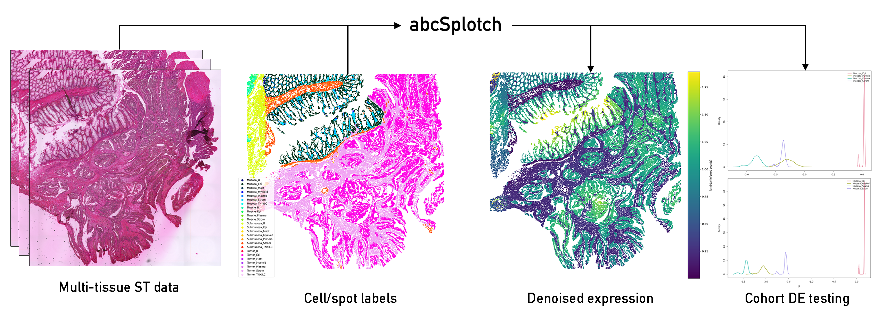

# abcSplotch
Approximate Bayesian inference of spatial cellular gene expression conditioned on sample covariates. 

## Features:
- Uses generalized linear model to denoise gene expression, disentangling effects of cell type, sample covariate, and local spatial autcorrelation
- Quantifies cohort-level differential expression across sample covariates and/or cell types 
- Efficient inference via integrated nested Laplace approximation (INLA) scales to tens of millions of spots/cells
- Compatible with Visium HD, Visium v1/v2, and original STv1
- Enables deconvolution of multi-cellular data (Visium v1/v2, STv1) via per-spot cellular composition estimates



## Installation

### 1. Clone the repository

```bash
git clone https://github.com/nygctech/abcSplotch.git
cd abcSplotch
```

---

### 2. Python Environment Installation

The preprocessing and downstream analysis tools are distributed as a Python package and are intended to run inside a Conda/Mamba environment.

We strongly recommend using `mamba` (or `micromamba`) with the `conda-forge` channel.

Create the environment:

```bash
mamba env create -f environment.yml
```

Activate the environment:

```bash
conda activate abcsplotch
```

---

### 3. Install the Python Package

Install the repository in editable mode:

```bash
pip install -e . --no-deps
```

This will:

- install the `abcSplotch` Python package
- create command-line executables from the package entry points
- keep the installation linked to the local repository for development

The `--no-deps` flag prevents `pip` from attempting to reinstall scientific dependencies already managed by Conda/Mamba.

### 4. Verify installation

```bash
splotch_prepare_count_files --help
splotch_generate_input_files --help
```

or

```bash
python -c "import splotch"
```

---

## R-INLA / Apptainer Backend

The Bayesian inference backend relies on a containerized R-INLA environment distributed via Docker/Apptainer.

We recommend using the provided Apptainer image directly on HPC systems.

Many HPC environments prohibit Docker execution directly on compute nodes. The recommended workflow is therefore:

1. Build Docker image locally or on a build node (must have x86 architecture)
2. Convert to Apptainer `.sif`
3. Transfer `.sif` to the cluster
4. Execute with `apptainer exec`

---

### 1. Build the Docker image

From the `containers/` directory:

```bash
cd containers

docker build -t abcsplotch-rinla:latest .
```

---

### 2. Build the Apptainer image

```bash
apptainer build \
    abcsplotch-rinla_latest.sif \
    docker-daemon://abcsplotch-rinla:latest
```

This produces a portable, immutable Apptainer image suitable for HPC execution. The `.sif` image is self-contained and reproducible across systems supporting Apptainer/Singularity.

---

### Optional: Create a Writable Sandbox

For debugging or interactive development:

```bash
apptainer build \
    --sandbox abcsplotch-rinla.sandbox \
    abcsplotch-rinla_latest.sif
```

Note that sandbox containers are mutable and therefore less reproducible than `.sif` images.

---

## Data preprocessing

abcSplotch currently supports processing of two classes of data:

### Cell-level ST (e.g., cell-segmented Visium HD)

```splotch_generate_input_files_hd``` processes raw data in the form of (cells x genes) AnnData objects, paired with a sample-level metadata table:

```bash
splotch_generate_input_files_hd \
    -c COUNT_FILES.h5ad \   # List of .h5ad-serialized AnnData files containing raw counts for each sample
    -m METADATA_FILE.tsv \  # Table mapping samples to counts ("Anndata File") and annotations ("Level [1/2/3]")
    -l NUM_LEVELS \         # Number of levels in the hierarchical model of sample annotations (1, 2 or 3)
    -s SCALING_FACTOR \     # Depth to which raw counts will be scaled (e.g., median sequencing depth)
    -d MIN_DEPTH \          # Drop cells with fewer than this many counts
    -o OUTPUT_DIRECTORY \   # Directory in which to save generated input files
    [-n/--no-car] \         # Disable spatial (CAR) model
    [-r REGION_SIZE] \      # Width of regions in which to model spatial effect (in units of CELL_X, CELL_Y)
    [-x CELL_X] \           # Column in input AnnData.obs containing cell x-coordinate
    [-y CELL_Y] \           # Column in input AnnData.obs containing cell y-coordinate
    [-a CELL_ANNOTATION]    # Column in input AnnData.obs containing cell type annotation
```

### Bin/spot-level ST (Visium, binned Visium HD, ST v1)

```splotch_generate_input_files``` operates identically to the [original cSplotch model](https://github.com/adaly/cSplotch#preparation-of-input-data-for-csplotch), processing the outputs of [Spaceranger](https://www.10xgenomics.com/support/software/space-ranger/latest) directly.

---

## Model execution

Example:

```bash
apptainer exec \
    abcsplotch-rinla.sif \              # or abcsplotch-rinla.sandbox
    Rscript abcSplotch/inla/abcsplotch.R \
    input.rdat \
    output_dir \
    [--draw-samples] \                      # to sample from the joint posterior (expensive)
    [--regional-precision prec]             # precision for regional bmy2 model (between log(100) and log(400))
```

## Downstream analysis & visualization


---
